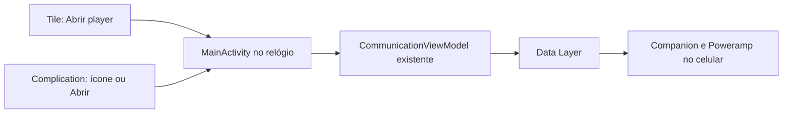

# Etapa 0.8 — acesso rápido no relógio

## Objetivo e escopo

A versão 0.8.0 acrescenta um Tile e uma Complication para abrir o Poweramp Remote, inclusive com a reprodução pausada ou parada. Os dois acessos levam à tela do player. Abrir o aplicativo não envia Play: a reprodução depende de uma ação explícita do usuário nos controles existentes.

O Tile é uma tela na sequência acessível deslizando a partir do mostrador. A Complication é um pequeno campo de um mostrador compatível, usado aqui como atalho. Não é um mostrador novo. A instalação disponibiliza os dois recursos; o usuário escolhe adicioná-los.

Esta etapa não retoma presets/bandas do equalizador nem acrescenta categorias à biblioteca. O Companion só recebe a atualização do número da versão, para manter os APKs identificados como 0.8.0; a comunicação continua usando os protocolos existentes.

## Como funciona



RemoteTileService recebe onTileRequest do Wear OS e devolve um layout ProtoLayout com título, descrição e botão. ProtoLayout descreve elementos que o sistema desenha fora da Activity; não usa os componentes Compose da tela principal. O botão contém LaunchAction com pacote e classe explícitos da MainActivity. O pacote real é com.powerampremote; com.powerampremote.wear é o namespace das classes. Confundir os dois impediria abrir o aplicativo.

O layout tem margens proporcionais à largura do relógio e conteúdo centralizado. Chip fornece um botão Material com área de toque própria. onTileResourcesRequest retorna um pacote vazio de recursos com a mesma versão informada pelo Tile: este layout contém somente texto e formas, sem imagens remotas. O método ready usa CallbackToFutureAdapter para entregar um ListenableFuture já concluído, sem criar uma tarefa de rede ou bloquear à espera do celular. Essa pequena biblioteca AndroidX evita acrescentar a biblioteca Guava completa apenas para produzir esse retorno.

RemoteComplicationService é uma fonte de dados solicitada pelo Wear OS. onComplicationRequest responde ao sistema pelo listener; getPreviewData fornece a aparência no seletor. O método data monta texto curto ou imagem monocromática, conforme o tipo solicitado. Tipos não suportados retornam null. A prévia não recebe ação de toque.

Na Complication real, PendingIntent.getActivity permite ao mostrador abrir a MainActivity com um Intent explícito. FLAG_IMMUTABLE impede que o destinatário altere o Intent; FLAG_UPDATE_CURRENT reutiliza a mesma ação. O Intent não força NEW_TASK nem CLEAR_TOP, seguindo a orientação do lint WearRecents para preservar o comportamento de tarefas do Wear OS. Abrir a Activity não envia comando ao Poweramp.

SHORT_TEXT apresenta Abrir, título Remote e ícone quando o mostrador permitir. MONOCHROMATIC_IMAGE apresenta só o símbolo. No Manifest, o identificador histórico desse segundo tipo é ICON. O mostrador decide tamanho, cor e quais campos exibir; nem todo espaço aceita esses tipos.

Ambos os serviços são exported porque o sistema precisa encontrá-los, mas cada um exige a permissão de vínculo própria do Wear OS. São permissões impostas a quem acessa o serviço, não novas solicitações de permissão ao usuário. A MainActivity já era exportada para o launcher.

Os atalhos não exibem música, conexão nem estado atual. FreshnessIntervalMillis=0 no Tile e UPDATE_PERIOD_SECONDS=0 na Complication não solicitam atualização periódica. O sistema pode chamar os serviços ao adicionar ou apresentar o recurso. Não há polling, WorkManager, wake lock ou serviço permanente acrescentado. Ao abrir a Activity, passam a valer os ciclos de vida e as consultas já existentes do player.

## Arquivos e equivalentes em Java

| Arquivo | O que faz | O que modificar aqui |
| --- | --- | --- |
| wear/quickaccess/RemoteTileService.kt | Monta o Tile e sua ação de abertura | Espaçamentos, cores, disposição e botão |
| wear/quickaccess/RemoteComplicationService.kt | Fornece ícone/texto e ação do mostrador | Texto exibido, tipos suportados e PendingIntent |
| wear/src/main/res/values/quick_access.xml | Centraliza os textos | Rótulos e descrição de acessibilidade |
| wear/src/main/res/drawable/ic_remote.xml | Símbolo vetorial branco | Forma do ícone; preserve uma única cor |
| wear/src/main/res/drawable/tile_preview.xml | Ilustração no seletor de Tiles | Prévia decorativa; não é o layout real |
| wear/src/main/AndroidManifest.xml | Registra os dois serviços | Permissões, ações, tipos e metadados |
| gradle/libs.versions.toml | Fixa as bibliotecas oficiais | Versões após verificar compatibilidade |
| wear/build.gradle.kts | Inclui as dependências | Bibliotecas usadas apenas pelo relógio |

class RemoteTileService : TileService() equivale a extends TileService em Java. override indica a implementação de um método herdado. Os encadeamentos Builder().set...().build() usam o mesmo padrão Builder comum no Java. private limita a visibilidade, e companion object guarda a constante compartilhada da classe, papel semelhante ao de um static final.

when escolhe a implementação pelo tipo de Complication, como um switch. O retorno ComplicationData? permite null explicitamente. Um listener é um objeto de callback, como as interfaces de eventos usadas em Java. Recursos R.string separam os textos do código, permitindo alterar rótulos sem mexer na lógica.

## Exercícios para modificar depois

1. Troque quick_access_open de Abrir player para Abrir Remote. Compile e confira se o texto cabe no relógio pequeno.
2. Em RemoteTileService, altere a cor 0xFFD0BCFF do fundo do Chip. O formato é AARRGGBB: FF é opacidade total. Confira contraste com a cor do texto 0xFF21182E.
3. Altere um Spacer de 12f para 8f e compare. dp define distância independente da densidade; sp é usado no tamanho da fonte. Verifique tanto o Tile quanto a prévia: são recursos separados.
4. Troque o texto Abrir da Complication, mantendo-o curto. Teste no mostrador escolhido, pois ele determina o espaço disponível e pode ocultar o título.

Após qualquer mudança, compile, reinstale e confira o resultado. O Wear OS pode manter dados em cache: remova e adicione novamente o Tile ou a Complication se o conteúdo antigo persistir. Para mudar o destino para Biblioteca seria necessário tratar uma intenção de navegação na Activity; trocar só o rótulo não altera o destino. Não acrescente Play à ação de abertura sem decidir explicitamente mudar esse comportamento.

## Instalar e testar

Compile e valide na raiz do projeto:

```powershell
.\gradlew.bat :mobile:assembleDebug :wear:assembleDebug
.\gradlew.bat :mobile:testDebugUnitTest :wear:testDebugUnitTest
.\gradlew.bat :mobile:lintDebug :wear:lintDebug
```

Atualize os APKs pelo [guia de instalação](INSTALL_PHYSICAL.md). Use install -r e a mesma assinatura para preservar os dados. O endereço de conexão ADB do relógio pode mudar; use IP:porta com dois-pontos. A depuração sem fio serve para instalar, não para manter o aplicativo funcionando.

### Tile no Watch 7

1. Pause a música no Poweramp e vá ao mostrador do relógio.
2. Deslize até o fim da sequência de Tiles e escolha adicionar um Tile. Também é possível usar a seção Tiles no Galaxy Wearable; os nomes variam conforme a One UI.
3. Escolha Poweramp Remote e confirme.
4. Abra o Tile e toque Abrir player. Confira a tela principal do Remote e que a música não começou sozinha.
5. Teste Play/Pause, Biblioteca, escolha de faixa e retorno ao player.

### Complication no Watch 7

1. Pressione e segure o mostrador, escolha personalizar e procure os campos de Complications. Alternativamente, personalize pelo Galaxy Wearable.
2. Escolha um campo compatível com texto curto ou ícone e selecione Poweramp Remote como fonte.
3. Salve, saia do editor e toque no atalho. Confira a abertura do Remote com a música ainda pausada.
4. Se Poweramp Remote não aparecer, tente outro campo ou mostrador com suporte aos tipos declarados. O aplicativo não pode impor um novo campo a um mostrador que não o oferece.

### Casos adicionais

- Saia do aplicativo e abra pelos dois atalhos novamente; confira também após encerrar seu processo normalmente.
- Teste com a biblioteca já aberta anteriormente: a ação deve levar ao player.
- Sem conexão com o celular, o atalho deve abrir o aplicativo; os controles continuam sujeitos à conexão e devem informar a indisponibilidade.
- Com ambos os aparelhos próximos e conectados por Bluetooth, desligue o Wi-Fi para verificar seu cenário de uso diário. Abertura do atalho é local; comunicação e comandos são verificados separadamente.
- Confira legibilidade, área de toque e contraste no mostrador real. Deixe a música pausada ao concluir os testes.

Os resultados efetivamente executados e as pendências estão em [TESTING.md](TESTING.md). A aprovação física da 0.7 não substitui os testes destes novos acessos na 0.8.

## Fontes oficiais consultadas

- [Wear Tiles — versão estável e dependências](https://developer.android.com/jetpack/androidx/releases/wear-tiles).
- [ProtoLayout — versão estável](https://developer.android.com/jetpack/androidx/releases/wear-protolayout).
- [TileService — callbacks e proteção do serviço](https://developer.android.com/reference/androidx/wear/tiles/TileService).
- [Ações de toque de Tiles](https://developer.android.com/training/wearables/tiles/interactions).
- [Fonte de Complications e Manifest](https://developer.android.com/training/wearables/complications/exposing-data).
- [Wear Watchface — bibliotecas de Complications permanecem suportadas](https://developer.android.com/jetpack/androidx/releases/wear-watchface).
